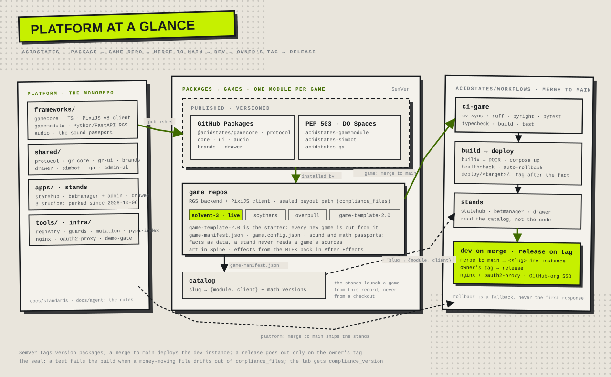

<picture>
  <source media="(prefers-color-scheme: dark)" srcset="assets/logo-dark.svg">
  
</picture>

### Spin. State. Repeat.

**A slot-games provider platform**: a Python RGS framework, a thin PixiJS client framework, a
sound passport, a simulator that prints the math passport for the lab, and the stands that test,
catalog and ship games.

[acidstates.com](https://acidstates.com)

---

## Platform at a glance

<picture>
  <source media="(prefers-color-scheme: dark)" srcset="assets/platform-dark.svg">
  
</picture>

A baked SVG in the brand canon, both themes from one geometry. <a href="https://github.com/acidstates/.github/blob/main/profile/tools/render_platform_diagram.py">Generator</a>: change the generator, never the SVG.

## Games

| Game | Repository | What it is |
|---|---|---|
| **SOLVENT 3** | [`solvent-3`](https://github.com/acidstates/solvent-3) | The live game. A chemistry-lab slot: a 6 x 5 board, 25 lines, explosions and shield fields, six flasks above the reels, free spins. |
| **SCYTHERS** | [`scythers`](https://github.com/acidstates/scythers) | A bio-lab slot. The backend, math, QA layer and drawer forked from SOLVENT 3; the client is the clean client of the starter. The repository was called `wetlab` until 2026-10-14, and its inner folders still use that name. |
| **OVERPULL** | [`overpull`](https://github.com/acidstates/overpull) | A crash game: a penguin on a slingshot. Hold the button, the multiplier climbs; let go before the rubber snaps. Every round is provably fair. |
| starter | [`game-template-2.0`](https://github.com/acidstates/game-template-2.0) | The GitHub template repository that every new game is cut from (`scripts/new-game.py`). |

## How we build games

> **Install the framework as a package. Write the game in its own repository. Merge to `main`: the dev instance deploys. The owner's tag makes a release.**

Each game is a small, independent repository that installs versioned framework packages. Games
ship on their own schedule while the platform changes under them. SemVer tags version the
packages. A merge to `main` deploys the game's dev instance `<slug>-dev`. A release goes out only
on the owner's tag. Each step that ships code to a running service does a health check and rolls
back on failure.

The game logic that moves money lives in one sealed file set. A stand learns about a game only
from data that the game declares (`game-manifest.json`, `game.config.json`, the sound passport,
the math passport). A stand never reads a game's sources.

Art is animated in Spine. Visual effects come only from the purchased RTFX pack, customised in
After Effects and exported to Spine. Code does not draw effects.

## Repositories

| Repository | What it is |
|---|---|
| [`platform`](https://github.com/acidstates/platform) | The monorepo. `frameworks/`: `gamecore` (TS + PixiJS client), `gamemodule` (Python and FastAPI RGS), `audio` (sound passport). `shared/`: protocol, gr-core, gr-ui (the HUD kit and its design system), brands, drawer, simbot, qa, admin-ui. `apps/`: statehub, betmanager with its admin SPA, drawer, and three studios that are parked. `tools/`: registry, guards, mutation, pypi-index and more. `infra/`: nginx, oauth2-proxy, demo-gate. `docs/standards/` and `docs/agent/`: the rules for games and for agents. |
| [`workflows`](https://github.com/acidstates/workflows) | Reusable GitHub Actions workflows for the whole organisation. All deploy logic lives here; game repositories only call it. It also holds `tools/sim_droplet.py`, which runs simulations on a temporary droplet. |
| [`solvent-3`](https://github.com/acidstates/solvent-3), [`scythers`](https://github.com/acidstates/scythers), [`overpull`](https://github.com/acidstates/overpull) | The games. Each one has its backend, client, GDD, QA layer and drawer in one repository. |
| [`game-template-2.0`](https://github.com/acidstates/game-template-2.0) | The starter for new games. |
| [`workspace`](https://github.com/acidstates/workspace) | The umbrella repository: the rules for agents in all repositories (`CLAUDE.md`, `AGENTS.md`), organisation skills, cross-repository specs and shared tools. |
| [`acid-states-website`](https://github.com/acidstates/acid-states-website) | [acidstates.com](https://acidstates.com), the public site. |
| [`acidstates-architecture`](https://github.com/acidstates/acidstates-architecture) | The architecture maps of the platform and the games, behind GitHub-organisation SSO. |

## Products

| Part | What it is |
|---|---|
| **gamemodule** | The Python and FastAPI RGS: command router, two-phase wallet, round journal, compliance seal, invariant suites. Its CLIs: `acid-seal` (per-file hashes and the `compliance_version` for the lab), `acid-shift` (replays the cheat vectors from the math passport), `acid-replay`, `acid-log-verify`, `acid-rng-dump`. |
| **gamecore** | The TS and PixiJS v8 client framework: a synchronous round kernel, the event bus that each game subscribes to, the overlay axis, copy and locale. The client draws the board only from the server's state. |
| **gr-core, gr-ui** | The shared client core and the HUD kit (`@acidstates/core`, `@acidstates/ui`). The HUD design system lives next to the kit. |
| **audio** | The sound passport: the manifest contract, a validator, codegen and the `acid-audio` CLI. |
| **simbot** | RTP and compliance simulation: `acid-simulate` prints the math passport for each math version; `acid-math-gate` keeps RTP inside its corridor in CI. |
| **qa** | `acid-qa`: one entry point for scenario runs and smokes against a game. |
| **drawer** | The round history that the player sees in the game, as certification requires. |
| **statehub** | The QA stand: the game catalog with an embedded player, device mockups and test panels. |
| **betmanager** | Accounts, wallets, ledger and cross-game analytics, with an admin SPA behind GitHub-organisation SSO. |
| **catalog** | The registry that maps each game to its pinned `{module, client}` and the math versions its backend accepts. |
| **studios** | Three authoring stands with MCP servers. They are parked since 2026-10-06, because they made effects in code. Effects now come from the RTFX pack through After Effects and Spine. |

## Published packages

| Registry | Packages |
|---|---|
| GitHub Packages (npm, private to the organisation) | `@acidstates/gamecore`, `@acidstates/protocol`, `@acidstates/core`, `@acidstates/ui`, `@acidstates/audio`, `@acidstates/brands`, `@acidstates/drawer` |
| PEP 503 index on DigitalOcean Spaces | `acidstates-gamemodule`, `acidstates-simbot`, `acidstates-qa` |

This page gives no version numbers. The registry is the source of truth: use
`npm view <package> dist-tags` or the index. All other workspace packages are `private: true`:
they deploy, they do not publish.

## How it ships

A merge of a PR into `main` builds and deploys. There is no manual SSH and no setup for each
developer. The logic lives in one place,
[`acidstates/workflows`](https://github.com/acidstates/workflows):

| Workflow | What it does |
|---|---|
| `ci-game` | PR gates: backend `uv sync`, `ruff`, `pyright`, `pytest`; client typecheck, build, test |
| `build-push-image` | buildx to the DigitalOcean Container Registry, tagged by commit SHA |
| `deploy-container` | pull by tag, compose up, health check, rollback on failure, deploy tag |
| `deploy-static` | build, backup, rsync, smoke, restore on failure, deploy tag |
| `deploy-game` | the orchestrator: finds what changed (backend or client), then CI, build, deploy, manifest registration and catalog rebuild |
| `deploy-infra` | nginx and oauth2-proxy: `nginx -t`, reload, smoke of each gated host, restore on any failure |
| `ondemand-runner` | makes sure the on-demand self-hosted runner droplet exists, then returns |
| `reproducibility-check` | builds the image twice from one commit and requires the same digest |
| `site-truth` | before a release, checks that the game's page on the website says what the game says about itself |

A game declares *where* it deploys in the `deploy` block of its `game-manifest.json`. That block
is the full contract between a game repository and the organisation's CI. CI does not ship a
manifest that still has its `CHANGE-ME` values.

Simulations run on a temporary DigitalOcean droplet that `tools/sim_droplet.py` creates for each
run. They never run on a developer's machine and never on the CI host.

## What proves it

- **Compliance seal.** Each game declares `compliance_files`. The framework hashes them into a
  `compliance_version`, and the lab gets the per-file hashes from `acid-seal`. A test fails the
  build when a file on the payout path leaves the set.
- **Determinism.** The server RNG is `hmac-sha256-ctr/1`, seeded per round. Golden tests replay
  committed seeds and pin the `compliance_version` for each math version.
- **The passport is data.** The simulator prints the math passport, and the framework parses it
  back and checks it against the settings. `acid-shift` proves that each cheat vector in the
  passport reproduces. `acid-math-gate` keeps RTP inside its corridor in CI.
- **Guards that bite.** Invariant suites have positive controls. A document that describes the
  wire (protocol fields, the sound passport) has a machine checker that fails when the code drifts.
- **Mutations, not only green runs.** A green suite proves nothing alone. `gamecore` breaks its
  kernel on purpose in CI and requires the *named* guard to fail. On the Python side, the mutation
  harness in `tools/mutation` proves each new guard before it is merged.

## Ready for agents

The codebase has its own manual for AI coding agents. `CLAUDE.md` and `AGENTS.md` go from the
umbrella repository down into each working repository. The platform keeps the game integration
standard (`docs/standards/`) and the agent standards for asset preparation, animation and PixiJS
drawing (`docs/agent/`). An agent reads them before it starts work.

---

© AcidStates · built for scale, shipped on merge.

